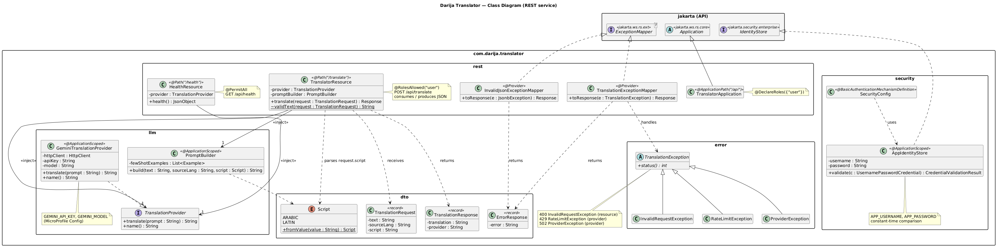
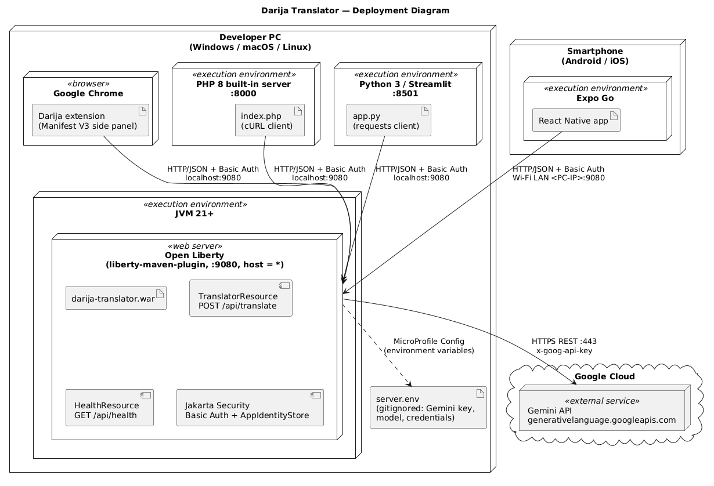

# Darija Translator

An LLM-powered RESTful web service that translates text (any language, usually English) into
**Moroccan Arabic (Darija)**, with four clients: a Chrome extension, a PHP web form, a Python
(Streamlit) app and a React Native (Expo) mobile app.

## Features

- **REST API** `POST /api/translate`: any source language (auto-detected, or given as `sourceLang`) into
  Moroccan Darija, explicitly *not* Modern Standard Arabic, in **Arabic script** or **Arabizi**
  (Latin letters with 3, 7, 9…). `GET /api/health` for a reachability check.
- **LLM-powered** by Google Gemini, called directly over HTTPS with a single, tested prompt and few-shot examples
  ([`docs/prompt.md`](docs/prompt.md)).
- **Secured** with HTTP Basic authentication (Jakarta Security, one configured user).
- **Consistent errors**: every failure maps to a status code (400, 401, 429, 502) and, except 401,
  a JSON `{ "error": "…" }` body that all clients show to the user.
- **Four clients**:
  - **Chrome extension**: select text on any page → right-click → *Translate to Darija* → the side panel opens
    with the text already filled in and translated; copy and read aloud.
  - **PHP** web form (plain cURL).
  - **Python** Streamlit app.
  - **React Native** app for Android/iOS (Expo Go), reaching the server over Wi-Fi.

## Architecture

```
 Chrome extension ─┐
 PHP web form ─────┤  HTTP + JSON        ┌──────────────── Open Liberty :9080 ───────────────┐   HTTPS
 Streamlit app ────┼─ Basic Auth ───────►│ Jakarta Security → TranslatorResource              │──────────► Gemini API
 Mobile (Expo Go) ─┘  (LAN for phone)    │    → PromptBuilder → TranslationProvider (Gemini) │
                                         └────────────────────────────────────────────────────┘
```

The server is a small layered Jakarta EE application (package `com.darija.translator`):

| Package | Responsibility |
|---|---|
| `rest` | JAX-RS application, the two resources, exception mappers |
| `dto` | request/response records and the `Script` enum |
| `llm` | `TranslationProvider` interface, `GeminiTranslationProvider`, `PromptBuilder` |
| `security` | Basic Auth mechanism and the identity store |
| `error` | `TranslationException` hierarchy, each subclass knowing its HTTP status |

**Class diagram**



**Deployment diagram**



Also in `docs/`: the [use case diagram](docs/use-case-diagram.png) and the
[sequence diagram](docs/sequence-diagram.png) of the extension's right-click flow.
PlantUML sources (`.puml`) sit next to each image.

## Repository layout

| Folder | Contents |
|---|---|
| `server/` | Java 21 REST service (Maven, Jakarta EE 10, Open Liberty) |
| `extension/` | Chrome extension (Manifest V3, side panel) |
| `php/` | PHP client (plain cURL web form) |
| `python/` | Python client (Streamlit) |
| `mobile/` | React Native client (Expo) |
| `postman/` | Postman collection for the API |
| `docs/` | UML diagrams, screenshots, demo script, blog draft |

## Tech stack and design choices

| Choice | Why |
|---|---|
| **Java 21 + Jakarta EE 10** (JAX-RS, CDI, JSON-B/JSON-P, Security, MicroProfile Config) | Standard APIs required by the course; no framework lock-in. |
| **Open Liberty via `liberty-maven-plugin`** | Runtime downloaded by Maven, `mvn liberty:dev` gives hot reload and nothing to install. |
| **Gemini through `java.net.http.HttpClient`** (no SDK) | One small REST call; avoids a heavy dependency and keeps the API key in a header. |
| **`TranslationProvider` interface** | The resource does not know which LLM it uses; another provider (e.g. a local Ollama model) can be added without touching it. |
| **One `PromptBuilder` with few-shot examples** | A single, unit-tested place for the prompt, tuned in Google AI Studio before coding. |
| **Exceptions that carry their HTTP status + one mapper** | Resources and providers just throw; the API's error format is defined in one place. |
| **Basic Auth + custom `IdentityStore`** | Simplest standard mechanism every client can use; constant-time password check. |
| **Config from environment variables (`server.env`)** | Secrets stay out of git; a missing variable stops the app with a message that names it. |
| **No CORS filter** | No client needs one: the extension uses `host_permissions`, PHP and Streamlit call from their server side, React Native is not a browser. |
| **Plain JavaScript extension, no build step** | Load unpacked and go; side panel API for a persistent translator. |
| **Expo / Expo Go** | Run the React Native app on a real phone without Android Studio or Xcode. |

## Testing

- **Unit tests** (JUnit 5, 26 tests): prompt building (scripts, source language, injection-safe placeholders),
  request validation, `Script` parsing, the exception mapper and the identity store. No test calls Gemini.

  ```bash
  cd server && mvn -q verify
  ```

- **Postman**: [`postman/darija-translator.postman_collection.json`](postman/darija-translator.postman_collection.json)
  covers health, translate (Arabic and Arabizi), 400 (blank, too long, bad script, malformed JSON) and 401
  (no credentials, wrong password), each with assertions. Set the `username` / `password` collection variables
  and use *Run collection*.
- **curl** examples are in the [API reference](#api-reference) below.

## Prerequisites

- **JDK 21 or newer** (the code targets Java 21)
- **Maven 3.9+** (downloads Open Liberty automatically, nothing to install)
- A **Gemini API key** from [Google AI Studio](https://aistudio.google.com/apikey)

## Configuration

All server variables are documented in [`.env.example`](.env.example). Secrets are never committed.

Open Liberty reads its configuration from environment variables (through MicroProfile Config) and does
**not** read a `.env` file from the repository root. Put your values in
`server/src/main/liberty/config/server.env` (gitignored; the Liberty Maven plugin copies it into the server):

```properties
LLM_PROVIDER=gemini
GEMINI_API_KEY=paste-your-key-here
GEMINI_MODEL=gemini-flash-model-name
APP_USERNAME=choose-a-username
APP_PASSWORD=choose-a-password
```

Write the values as plain text: no quotes, no `< >`, no spaces around `=`. On Windows, Liberty's start
script drops `!` and mangles non-ASCII characters in `server.env`, so keep the username and password to
ASCII letters, digits and punctuation other than `!`. `GEMINI_MODEL` is the exact
model name shown in Google AI Studio. `APP_USERNAME` / `APP_PASSWORD` are the Basic Auth credentials every
client must send.

Alternatively, export the same variables in your shell before starting the server.
If a required variable is missing or empty, the application does not start and the log names it
(e.g. `Failed to Inject @ConfigProperty for key APP_PASSWORD`); values are never logged.
After editing `server.env`, restart the server (dev mode does not reload it).

## Running

### Server

```bash
cd server
mvn liberty:dev        # dev mode with hot reload; press Enter to re-run tests, q to quit
```

The API is served at `http://localhost:9080/api` (and on your PC's LAN IP, port 9080).
Wait for `The defaultServer server is ready to run a smarter planet.` in the console.

Other commands:

```bash
mvn -q verify          # compile and run the unit tests
mvn liberty:run        # run without dev mode (Ctrl+C to stop)
```

### Chrome extension

Plain JavaScript, Manifest V3, no build step. Files in [`extension/`](extension/):

| File | Role |
|---|---|
| `manifest.json` | permissions `contextMenus`, `sidePanel`, `storage`; `host_permissions` for `http://localhost:9080/*` |
| `background.js` | service worker: "Translate to Darija" context-menu item, opens the side panel |
| `sidepanel.html/.js/.css` | the translator UI |
| `options.html/.js` | server URL, username, password, default script, "Test connection" |
| `api.js` | REST calls and error messages (shared) |
| `speech.js` | read aloud |

**Install**

1. Start the server (see above).
2. Open `chrome://extensions`, turn on **Developer mode**, click **Load unpacked** and pick the `extension/` folder.
3. Click the puzzle icon → pin **Darija Translator**. Right-click the icon → **Options**: enter the server URL
   (`http://localhost:9080`), the `APP_USERNAME` / `APP_PASSWORD` values, then **Test connection** and **Save**.
4. After changing extension code, click the reload ↻ button on the extension card.

**Use**

- Select text on any web page → right-click → **Translate to Darija**. The side panel opens with the text
  filled in and translates it immediately. Selecting more text while the panel is open translates the new text.
- Or click the toolbar icon to open the panel and type text (Ctrl+Enter translates).
- **العربية / Arabizi** switches the output script (and re-translates). **Copy** copies the result.
- **Read aloud** uses an `ar-MA` voice if installed, otherwise any Arabic voice. On Windows, add one via
  *Settings → Time & language → Speech → Add voices → Arabic*, then restart Chrome.

**Using another server address** (e.g. the PC's LAN IP): add it to `host_permissions` in `manifest.json`,
for example `"http://192.168.1.20:9080/*"`, reload the extension, then set the same URL in the options.
Without the permission Chrome blocks the request and the panel reports "Server not reachable".

### PHP client

A single page ([`php/index.php`](php/index.php)): a form, plain cURL with `CURLOPT_USERPWD`, a 40 s timeout,
the result right-to-left and the API's error messages. No Composer. All output is escaped with `htmlspecialchars`.

```bash
cd php
copy config.example.php config.php   # macOS/Linux: cp — then fill in api_url, username, password
php -S localhost:8000                # open http://localhost:8000
```

`php/config.php` is gitignored. The page needs PHP's **curl** extension. A Windows PHP without a `php.ini`
(e.g. installed with `winget install PHP.PHP.8.4`) does not load it: in the PHP folder, copy
`php.ini-development` to `php.ini`, then uncomment `extension_dir = "ext"` and `extension=curl`.
Check with `php -m` (the list must contain `curl`).

### Python client

A [Streamlit](https://streamlit.io) app ([`python/app.py`](python/app.py)) using `requests` with Basic Auth.
It shows a health check in the sidebar, a text area, an Arabic / Arabizi selector, the result right-to-left
(plus a copyable code block) and the API's error messages.

```bash
cd python
python -m venv .venv
.venv\Scripts\activate          # macOS/Linux: source .venv/bin/activate
pip install -r requirements.txt
copy .env.example .env          # macOS/Linux: cp .env.example .env  — then fill in the values
streamlit run app.py            # opens http://localhost:8501
```

`python/.env` (gitignored) holds `DARIJA_API_URL`, `DARIJA_USERNAME` and `DARIJA_PASSWORD`;
real environment variables take precedence over the file.

### Mobile client

A React Native app ([`mobile/`](mobile/), Expo, TypeScript) that runs in **Expo Go**. Two screens:
**Translate** (text, Arabic / Arabizi toggle, RTL result, copy, read aloud with `expo-speech`) and
**Settings** (server URL, username, password, "Test connection"; saved encrypted with `expo-secure-store`).

The phone must reach the server over Wi-Fi, so the URL is the **PC's LAN IP**, never `localhost`
(on the phone, `localhost` is the phone itself).

1. Find the PC's IP: run `ipconfig` and take the IPv4 address under **Wireless LAN adapter Wi-Fi**
   (ignore VirtualBox/VMware adapters such as `192.168.56.x`).
2. Put the phone on the **same Wi-Fi**. On first start, Windows may ask whether Java can use the network:
   allow **private networks**, otherwise the firewall blocks port 9080.
3. Check from the phone's browser: `http://<PC-IP>:9080/api/health` should show `{"status":"ok",...}`.
4. Configure and start:

```bash
cd mobile
npm install
copy .env.example .env      # macOS/Linux: cp — then set EXPO_PUBLIC_API_URL, _USERNAME, _PASSWORD
npx expo start              # scan the QR code with Expo Go (Android) or the Camera app (iOS)
```

`mobile/.env` is gitignored. Its values are only defaults: the Settings screen can change them on the phone.
Note that `EXPO_PUBLIC_*` values are embedded in the JavaScript bundle, which is fine for a local demo
but not for a published app.

## API reference

### `POST /api/translate`

Requires HTTP Basic authentication (`Authorization: Basic <base64(username:password)>`).

Request (`Content-Type: application/json`):

```json
{ "text": "Where is the train station?", "sourceLang": "en", "script": "arabic" }
```

| Field | Required | Notes |
|---|---|---|
| `text` | yes | 1–5,000 characters after trimming |
| `sourceLang` | no | ISO code such as `en`, `fr`; auto-detected when absent |
| `script` | no | `arabic` (default) or `latin` (Arabizi), case-insensitive |

Success — `200`:

```json
{ "translation": "فين كاينة لاگار؟", "provider": "gemini" }
```

Errors have the body `{ "error": "<message>" }` (except 401, see below):

| Status | When |
|---|---|
| 400 | `text` missing, blank or longer than 5,000 characters; invalid `script`; malformed JSON |
| 401 | missing or wrong credentials (empty body plus a `WWW-Authenticate: Basic realm="darija"` header; sent by Jakarta Security before the application code runs) |
| 429 | the LLM provider's rate limit was hit — wait and retry |
| 502 | the LLM call failed, timed out or returned no text |

### `GET /api/health`

No authentication. `200 { "status": "ok", "provider": "gemini" }`.

### curl examples

(Git Bash, macOS or Linux. Replace `USER:PASS` with the values of `APP_USERNAME` / `APP_PASSWORD`.
In Windows `cmd`, use double quotes and escape the inner ones: `-d "{\"text\": \"Hello\"}"`.)

```bash
# Health check
curl http://localhost:9080/api/health

# Translate into Arabic script
curl -X POST http://localhost:9080/api/translate -u USER:PASS \
  -H "Content-Type: application/json" \
  -d '{"text": "Where is the train station?", "sourceLang": "en"}'

# Translate into Arabizi
curl -X POST http://localhost:9080/api/translate -u USER:PASS \
  -H "Content-Type: application/json" \
  -d '{"text": "I am going to the market to buy bread.", "script": "latin"}'

# 400: blank text
curl -X POST http://localhost:9080/api/translate -u USER:PASS \
  -H "Content-Type: application/json" -d '{"text": "  "}'

# 401: no credentials, then a wrong password (-i shows the status line)
curl -i -X POST http://localhost:9080/api/translate \
  -H "Content-Type: application/json" -d '{"text": "Hello"}'
curl -i -X POST http://localhost:9080/api/translate -u USER:wrong-password \
  -H "Content-Type: application/json" -d '{"text": "Hello"}'
```

A Postman collection with the same requests (and test assertions) is in
[`postman/darija-translator.postman_collection.json`](postman/darija-translator.postman_collection.json).
Import it, then set the `baseUrl`, `username` and `password` collection variables.

## Security notes

- **Basic Auth over plain HTTP is acceptable only on a trusted local network** (home or campus Wi-Fi for the demo).
  Credentials are base64-encoded, not encrypted; anyone on the network can read them. A real deployment needs HTTPS.
- The server listens on all interfaces (`host="*"`) so the phone can reach it over Wi-Fi.
- One user, configured with `APP_USERNAME` / `APP_PASSWORD`; passwords are compared in constant time.
- `/api/health` is public; `/api/translate` requires the `user` role.
- Secrets live only in `server/src/main/liberty/config/server.env` or shell variables, both outside git
  (`.gitignore` covers `.env`, `server.env` and `php/config.php`). The Gemini key is sent in the
  `x-goog-api-key` header, never in a URL, and neither keys, passwords nor the text to translate are logged.

## Troubleshooting

| Symptom | Cause and fix |
|---|---|
| Every page is a Liberty "Context Root Not Found" 404 | The app did not start. The console shows `CWWKZ0002E` and names the missing variable (`Failed to Inject @ConfigProperty for key …`): add it to `server.env` and restart. |
| `502` "Gemini HTTP 503" | Google's model is overloaded. Retry after a minute, or set `GEMINI_MODEL` to a lighter model such as a Flash-Lite one. |
| `502` "Gemini HTTP 404" / "misconfigured" | Wrong `GEMINI_MODEL` (check the exact name, without `models/`, `< >` or quotes). |
| `502` "did not answer in time" | Gemini took more than 30 s; retry. |
| `401` with the right password | The password contains `!` or non-ASCII characters, which Liberty's Windows start script mangles in `server.env`. |
| Extension: "Server not reachable" | Server not running, or the URL is not in `host_permissions` in `manifest.json`. |
| Phone cannot connect | Wrong IP (use the Wi-Fi adapter's), phone on another network, or Windows firewall blocking Java on private networks. |

## Screenshots

Screenshots go in [`docs/screenshots/`](docs/screenshots/):

| Chrome extension | PHP | Streamlit | Mobile |
|---|---|---|---|
|  |  |  |  |

## Demo video and blog

- Demo video (5 min): _link to be added_ — script in [`docs/demo-script.md`](docs/demo-script.md)
- Blog post: _link to be added_ — draft in [`docs/blog-draft.md`](docs/blog-draft.md)

## Author

Bashir Mouri — _course name, university, year to be added_
